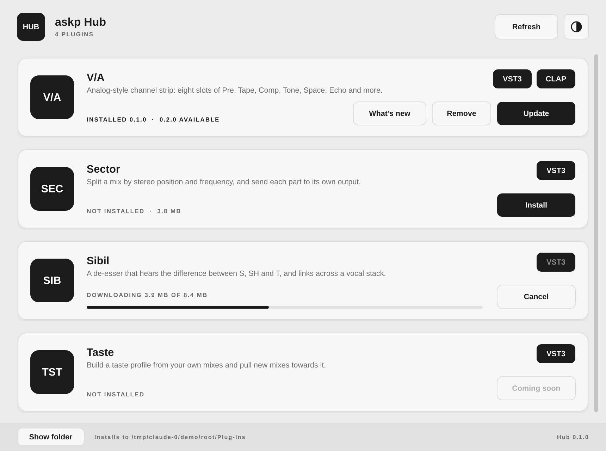

# fueledby Hub

One app to install, update and remove fueledby plugins (V/A, V/A Lab, Sector, Sibil, Taste, Grille). Share one
DMG (Mac) or setup EXE (Windows); people pick plugins and formats inside the app.



How it works, where files go, and what signing needs: [docs/DESIGN.md](docs/DESIGN.md).

## Build

```bash
# Mac (reuse V/A's JUCE copy to save disk):
cmake -S . -B build -DCMAKE_BUILD_TYPE=Release -DCMAKE_OSX_ARCHITECTURES="arm64;x86_64" \
      -DCMAKE_OSX_DEPLOYMENT_TARGET=11.0 \
      -DFETCHCONTENT_SOURCE_DIR_JUCE="$PWD/../V-A/build/_deps/juce-src"
cmake --build build --config Release
ctest --test-dir build -C Release --output-on-failure
open "build/Hub_artefacts/Release/fueledby Hub.app"

packaging/macos/make-dmg.sh "build/Hub_artefacts/Release/fueledby Hub.app"   # -> dist/fueledby-Hub-macOS.dmg
```

Linux builds too (the cloud checks run there): install the JUCE Linux deps plus libcurl.

## Publish a plugin version

1. Build the plugin in Release (universal on Mac: `-DCMAKE_OSX_ARCHITECTURES="arm64;x86_64"` and
   `-DCMAKE_OSX_DEPLOYMENT_TARGET=11.0`).
2. From this repo: `tools/package-plugin.sh va 0.2.0 ../V-A/build/VA_artefacts/Release`
   (add `win` as a 4th argument for a Windows build). Add absolute file or directory
   paths after the platform to include credits and licences. All listed formats must exist. It zips the bundles into `dist/`,
   and writes the URL, size, SHA-256 and formats into `manifest.json`.
3. Upload the zip with the `gh release create ...` line it prints (or drag it into a new
   release on GitHub named the same as the tag).
4. Commit and push `manifest.json`. Every Hub sees the update on its next check
   (at launch, or Refresh).

Before pushing the manifest, verify every download, its SHA-256 and size, bundle
versions, Windows x64 binaries, and Grille's bundled IR credits:

```bash
python3 tools/verify-manifest.py --require-platform mac --require-platform win
```

Plugin releases must use `gh release create ... --latest=false`. The Hub installers
use `releases/latest`, so the Hub release must remain marked Latest.

To publish the Hub itself, upload `fueledby-Hub-macOS.dmg` / `fueledby-Hub-Windows-Setup.exe` to a
`hub-v<version>` release and bump `hub.version` in `manifest.json`; older Hubs then show a
download banner.

## Plugin submissions

Community creators can send a plugin from the Hub (**Submit a plugin**). Submissions go to a review queue,
never straight into `manifest.json`. Service, API and review steps: [submissions/README.md](submissions/README.md).

## Testing without touching your plug-in folders

```bash
FUELEDBY_HUB_ROOT=/tmp/hub-sandbox "build/Hub_artefacts/Release/fueledby Hub.app/Contents/MacOS/fueledby Hub" \
    --manifest /path/to/test-manifest.json
```

`FUELEDBY_HUB_ROOT` puts every plug-in folder and the Hub's data under that folder. `--manifest`
(or `FUELEDBY_HUB_MANIFEST`) reads another list, local file or URL. `--snapshot out.png [--dark]`
renders the window to a PNG and quits.

## For testers

**Mac:** open the DMG, drag fueledby Hub to Applications, double-click it. The first time macOS
says it can't check the app: press Done, open System Settings > Privacy & Security, scroll
down and press **Open Anyway**. After that it opens normally. Pick a plugin, press Install,
then fully quit and reopen your DAW.

**Windows:** run fueledby-Hub-Windows-Setup.exe. If Windows says it protected your PC, click
**More info > Run anyway**. Then open fueledby Hub from the Start menu.

## The askp → fueledby rename (Hub 0.2.1)

The brand is now fueledby (fueledby.cc). What changed and what deliberately didn't:

- **Renamed:** app name (`fueledby Hub`), window and header text, DMG/Setup file names,
  the Windows plug-in folders (`Common Files\VST3\fueledby`, `CLAP\fueledby`), the Hub's data
  folder (`fueledby Hub`), the shared look folder (`fueledby/Look.settings`, `Themes/*.fueledbytheme`),
  built-in theme ids (`fueledby.studio` ...), and env overrides (`FUELEDBY_HUB_ROOT`, `FUELEDBY_HUB_MANIFEST`,
  `FUELEDBY_LOOK_DIR`, `FUELEDBY_THEME`).
- **Moved automatically:** on first launch the Hub moves its old `askp Hub` data folder and, on
  Windows, any plugins in the old `askp` folders. The look engine copies the old `askp/Look.settings`
  and Themes once. Old `askp.*` theme ids, `.askptheme` files and `ASKP_*` overrides still work.
- **Kept on purpose:** the Mac bundle id `com.askp.hub` (macOS keeps the app's settings and
  permissions), the Windows Setup AppId (the new Setup replaces the old Hub), and the GitHub
  URLs under `askp-dev` (the manifest URL is built into every installed Hub).
- **When publishing 0.2.1:** the release assets are now `fueledby-Hub-macOS.dmg` and
  `fueledby-Hub-Windows-Setup.exe`, so update `hub.download` in `manifest.json` in the same change.
